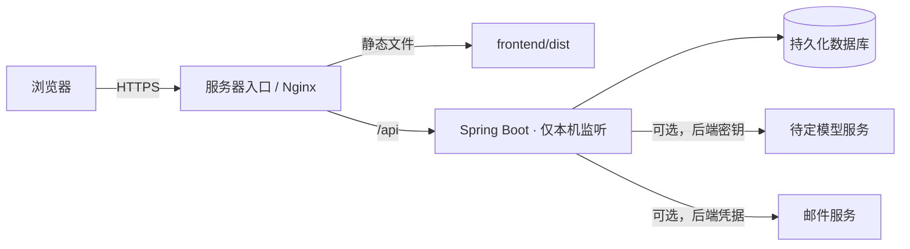

# 腾讯云服务器部署准备（尚未部署）

已确定的是**服务器平台**，尚未确定实例类型、操作系统、域名及大模型服务商。下面是目标结构与上线门槛，当前 Demo 仍只在本机运行。

## 当前可准备的部分

1. 前端使用 `npm.cmd run build` 生成静态文件；后端使用 Maven Wrapper 的 `verify` 生成 JAR。两者已在本机通过。前端 API 使用同源 `/api`，适合由服务器入口统一转发。
2. 后端默认监听 `127.0.0.1`，模型密钥、邮件口令和数据库凭据由进程环境提供。服务器入口应只向外提供 HTTPS；应用端口 8080 与开发端口 5173 不直接暴露。
3. 若选腾讯云 CVM，按实际实例和地域检查安全组，只开放网站所需的 80/443，并收紧管理入口。腾讯云官方的[安全组说明](https://cloud.tencent.com/document/product/213/15377)列出了 Web 服务常用端口；证书与域名需另行准备。

## 公开访问前必须完成

- **账号与隐私**：默认本机验证码会拒绝代理转发请求，无法在公网使用；实验性 SMTP 仍需真实送达、重发与滥用测试。补齐 CSRF 防护、按 IP 与邮箱限流、敏感数据保护、隐私告知、删除与备份策略。当前 H2 文件存储不适合直接承载真实健康资料；迁移数据库前须验证 schema、索引及备份恢复。
- **AI 与健康内容**：确定模型提供商及预算，真实联调并完成回答安全评测；逐条核验摘要与原文对应关系，进行医疗专业审核。现在的 Mock 和引用编号检查不能代替这些工作。
- **运行**：准备域名与 HTTPS、进程管理和故障重启、健康检查、日志脱敏、数据库备份与恢复演练；在桌面和手机上用公开域名重新测试完整路径。
- **参赛材料**：补齐团队信息、技术 PDF、评审访问说明及真实测试记录。不得把当前本机截图称为已部署结果。

确定服务器实例、系统和域名后，再写对应的操作脚本与配置。不要将服务器登录信息、API Key、SMTP 口令或真实健康数据写进仓库。
