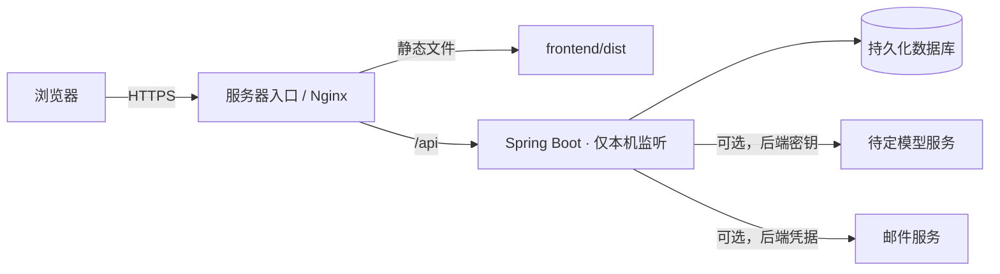

# 腾讯云轻量应用服务器部署准备（尚未部署）

2026-10-28 用户提供的控制台截图确认：**Lighthouse 轻量应用服务器，中国香港三区，2 核、2GB 内存、40GB SSD，运行中**。公网 IPv4 已分配，但不在仓库记录地址。操作系统、登录方式、域名及大模型服务仍待确认。当前 Demo 仍只在本机运行。

## 当前可准备的部分

1. 前端使用 `npm.cmd run build` 生成静态文件；后端使用 Maven Wrapper 的 `verify` 生成 JAR。两者已在本机通过。前端 API 使用同源 `/api`，适合由服务器入口统一转发。2GB 实例上应**在本机构建后上传产物**，避免服务器同时运行 Node、Maven 与 Java 编译进程。
2. 后端默认监听 `127.0.0.1`，模型密钥、邮件口令和数据库凭据由进程环境提供。服务器入口应只向外提供 HTTPS；应用端口 8080 与开发端口 5173 不直接暴露。
3. 此实例使用 Lighthouse 的**实例防火墙**，而非 CVM 安全组。按实际系统检查 80/443 和管理端口，管理入口只允许可信来源；不要向公网放通 8080、5173 或 H2。腾讯云的[实例防火墙操作说明](https://cloud.tencent.com/document/product/1207/44577/)与[防火墙案例](https://cloud.tencent.com/document/product/1207/136745)可用于核对规则。域名与 HTTPS 证书需另行准备。
4. 若镜像是 Linux，可用 Nginx + systemd 管理服务并为 Java 设置内存上限（初步预留 512MB 堆，联调时观察总内存）。若镜像是 Windows Server，需改用对应服务管理方案；确认系统前不执行安装或部署命令。
5. 本机已生成 `output/release/xike-runtime.zip`，包含 JAR、静态文件与 Linux 配置示例。上传前请阅读 `deploy/README.md`；此包没有密钥或本机 H2 数据，上传它本身不会自动启动网站。

## 公开访问前必须完成

- **账号与隐私**：默认本机验证码会拒绝代理转发请求，无法在公网使用；实验性 SMTP 仍需真实送达、重发与滥用测试。补齐 CSRF 防护、按 IP 与邮箱限流、敏感数据保护、隐私告知、删除与备份策略。当前 H2 文件存储不适合直接承载真实健康资料；迁移数据库前须验证 schema、索引及备份恢复。
- **AI 与健康内容**：确定模型提供商及预算，真实联调并完成回答安全评测；逐条核验摘要与原文对应关系，进行医疗专业审核。现在的 Mock 和引用编号检查不能代替这些工作。
- **运行**：准备域名与 HTTPS、进程管理和故障重启、健康检查、日志脱敏、数据库备份与恢复演练；在桌面和手机上用公开域名重新测试完整路径。
- **参赛材料**：团队信息和 8 页技术 PDF 已准备；仍需评审访问说明中的正式地址及真实部署测试记录。不得把当前本机截图称为已部署结果。

确定操作系统、域名和访问方式后，再写对应的操作脚本与配置。不要将服务器登录信息、API Key、SMTP 口令或真实健康数据写进仓库。
